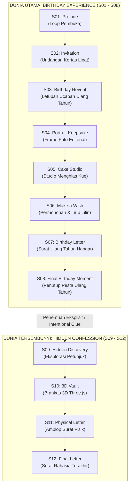

# Dokumentasi Struktur Folder Lengkap — The Last

> **Proyek:** The Last (*"A Keepsake That Slowly Opens"*)  
> **Arsitektur:** Next.js 16 (App Router) + React 19 + TypeScript + Tailwind CSS v4 + Motion + Three.js / R3F + Zustand + Playwright + Vitest  
> **Arah Desain:** *Warm Kinetic Editorial Keepsake* (*Editorial Surface-First*)  
> **Terakhir Diperbarui:** 2026-10-19  

---

## 1. Ringkasan Eksekutif & Statistik Proyek

Proyek ini adalah aplikasi web interaktif privat layar penuh (*full-screen, scene-based interactive keepsake*) yang dirancang dalam dua lapis dunia:
1. **Birthday World (S01 – S08):** Pengalaman utama perayaan ulang tahun (Prelude, Invitation, Reveal, Portrait, Cake Studio, Make a Wish, Birthday Letter, Final Birthday Moment).
2. **Hidden World (S09 – S12):** Lapisan rahasia yang dibuka melalui penemuan eksplisit (*Hidden Discovery, 3D Vault GLB, Physical Letter, Final Confession Letter*).

### Ringkasan Jumlah Direktori dan Berkas
- **Total Direktori:** 42 folder (di luar `.git`, `node_modules`, dan `.next`)
- **Total Berkas:** 146 berkas aktif
- **Pondasi Validasi:** Dilengkapi dengan *Asset Authorization Registry*, *Evidence Packaging Pipeline*, *Release Readiness Validator*, serta *Full-Coverage Automated Unit & E2E Tests*.

---

## 2. Diagram Pohon Struktur Lengkap (Directory Tree)

```text
theLast/
├── app/                                        # Next.js App Router (Entrypoint & Root Shell)
│   ├── globals.css                             # Tailwind v4 theme, styling token, & font variables
│   ├── layout.tsx                              # Root layout HTML & metadata viewport
│   └── page.tsx                                # Root page yang merender <ExperienceShell />
├── assets/                                     # Raw/Source Design Assets
│   ├── favicon.png                             # Master icon proyek
│   └── malica.webp                             # Foto potret protagonis
├── docs/                                       # Dokumentasi Otoritatif & Spesifikasi Desain
│   ├── DESIGN_SYSTEM.md                        # Master spesifikasi desain sistem, token, & kurva animasi
│   ├── IMPLEMENTATION_PLAN.md                  # Rencana fase implementasi P0 hingga P6
│   ├── MANIFEST.json                           # Manifest integritas berkas dokumentasi
│   ├── PRD.md                                  # Product Requirements Document & Acceptance Criteria (AT-01..AT-18)
│   └── README.md                               # Catatan handoff pengantar
├── font/                                       # Asset Tipografi Mandiri (Local Variable Web Fonts)
│   ├── licenses/                               # Lisensi legal font (SIL Open Font License)
│   │   ├── bricolage-OFL.txt                   # Lisensi untuk Bricolage Grotesque
│   │   ├── newsreader-OFL.txt                  # Lisensi untuk Newsreader
│   │   ├── newsreader-trademarks.md            # Catatan merek dagang Newsreader
│   │   └── shantell-sans-OFL.txt               # Lisensi untuk Shantell Sans
│   ├── BricolageGrotesque[opsz,wdth,wght].woff2# Font judul modern display
│   ├── Newsreader-Italic[opsz,wght].woff2      # Font serif editorial (italic)
│   ├── Newsreader[opsz,wght].woff2             # Font serif editorial (regular)
│   ├── PRODUCTION_FONT_PROVENANCE.txt          # Verifikasi hash SHA-256 dan asal-usul font
│   └── Shantell_Sans-Normal-Regular.woff2      # Font tulisan tangan untuk elemen surat/catatan
├── planning/                                   # Dokumen Kelangsungan Proyek & Handoff
│   └── handoff/
│       ├── NEW_CHAT_BOOTSTRAP.md               # Panduan bootstrap sesi agen/developer baru
│       └── THELAST_PROJECT_CONTINUITY_MASTER.md# Ringkasan master kontinuitas & status kesiapan rilis
├── public/                                     # Aset Statis Publik (Disajikan langsung ke browser)
│   └── assets/
│       ├── favicon.png                         # Favicon publik
│       ├── svg/                                # Vektor SVG resmi yang lolos validasi integritas
│       │   ├── cake/                           # Vektor modular untuk Scene 5 (Cake Studio)
│       │   │   ├── cake-accent-pearl.svg       # Aksen ornamen mutiara kue
│       │   │   ├── cake-accent-ribbon.svg      # Ornamen pita kue
│       │   │   ├── cake-body-base.svg          # Bentuk dasar tingkat kue
│       │   │   ├── cake-frosting-edge.svg      # Detail garis lelehan krim
│       │   │   ├── cake-frosting-silhouette.svg# Siluet lapisan frosting
│       │   │   ├── cake-topper.svg             # Hiasan atas kue (topper)
│       │   │   ├── candle-body.svg             # Batang lilin ulang tahun
│       │   │   ├── candle-flame.svg            # Api lilin animasi
│       │   │   ├── candle-smoke.svg            # Efek asap saat lilin ditiup
│       │   │   ├── candle-wick.svg             # Sumbu lilin
│       │   │   ├── flower-bloom.svg            # Bunga mekar dekorasi kue
│       │   │   └── flower-leaf.svg             # Daun dekorasi kue
│       │   ├── celebration/                    # Vektor perayaan untuk Scene 3 (Birthday Reveal)
│       │   │   ├── celebration-arc.svg         # Garis lengkung busur perayaan
│       │   │   └── celebration-burst.svg       # Efek letupan confetti/burst
│       │   ├── editorial/                      # Vektor frame untuk Scene 4 (Portrait)
│       │   │   └── editorial-frame-portrait.svg# Bingkai foto editorial
│       │   ├── paper/                          # Vektor tekstur lipatan untuk Scene 2 (Invitation)
│       │   │   └── invitation-paper-fold.svg   # Efek garis lipatan kertas undangan
│       │   └── signature/                      # Vektor tanda tangan untuk Scene 1 (Prelude)
│       │       └── offset-loop-open.svg        # Grafis loop pembuka interaktif
│       └── vault/                              # Aset 3D untuk Scene 10 (Vault)
│           └── vault-final.glb                 # Model 3D GLTF/GLB brankas interaktif
├── scripts/                                    # Skrip Otomatisasi & Setup Pengujian
│   ├── playwright-e2e-global-setup.mjs         # Inisialisasi global environment untuk Playwright
│   └── start-e2e-server.mjs                    # Skrip menjalankan server dev lokal untuk pengujian E2E
├── src/                                        # Kode Sumber Utama Aplikasi (TypeScript)
│   ├── assets/                                 # Subsistem Keamanan & Otorisasi Aset
│   │   └── authorization/
│   │       ├── index.ts                        # Public export barrel otorisasi aset
│   │       ├── internal.ts                     # Komputasi hashing SHA-256 internal & normalisasi path
│   │       ├── policy.ts                       # Aturan kepatuhan aset (whitelist, format, integritas)
│   │       ├── registry-definitions.ts         # Daftar hash otoritatif untuk SVG dan GLB
│   │       ├── registry.ts                     # API pengecekan aset terotorisasi
│   │       ├── types.ts                        # Definisi tipe aset, status verifikasi, dan payload
│   │       └── vault-v2.ts                     # Validasi khusus aset 3D Vault
│   ├── cake/                                   # Logika Domain Dekorasi Kue (Scene 5)
│   │   └── configuration.ts                    # Opsi kustomisasi kue (rasa, warna, frosting, lilin)
│   ├── evidence/                               # Pipeline Pengemasan Bukti Uji & Rilis
│   │   └── packaging/
│   │       ├── archive.ts                      # Utilitas arsip/kompresi ZIP
│   │       ├── cli.ts                          # CLI runner: npm run package:evidence
│   │       ├── inventory.ts                    # Pencatat inventaris artefak pengujian
│   │       ├── packager.ts                     # Modul orkestrasi pembuatan bundel bukti rilis
│   │       ├── policy.ts                       # Kebijakan kelayakan artefak yang boleh dikemas
│   │       ├── profiles.ts                     # Profil bundel bukti (dev, strict, release)
│   │       ├── types.ts                        # Tipe data bukti rilis dan manifes paket
│   │       └── zip-bridge.ps1                  # Bridge PowerShell untuk kompresi ZIP Windows
│   ├── release/                                # Validasi Kesiapan Rilis (Release Readiness Gate)
│   │   ├── cli.ts                          # CLI runner: npm run validate:release
│   │   ├── filesystem.ts                   # Pengecekan konsistensi struktur direktori berkas
│   │   ├── policy.ts                       # Pintu gerbang rilis (checklist aturan siap rilis)
│   │   ├── scene-registry.ts               # Registry deklarasi ke-12 scene terdaftar
│   │   ├── svg-integrity.ts                # Validator keamanan SVG (anti XSS/script injection)
│   │   ├── trusted-readiness.ts            # Evaluator skor & status kesiapan rilis
│   │   ├── types.ts                        # Tipe data audit rilis dan status enum
│   │   └── validator.ts                    # Validator terpusat untuk keseluruhan proyek
│   ├── runtime/                                # Mesin Transisi & State Machine Runtime
│   │   ├── contracts.ts                    # Kontrak definisi scene, payload event, dan ID scene
│   │   ├── guards.ts                       # Syarat transisi (pengecekan izin, consent, state)
│   │   ├── transition-coordinator.ts       # Koordinator animasi transisi antar scene
│   │   └── transition-engine.ts            # Mesin eksekusi pergantian scene aktif
│   ├── state/                                  # Manajemen State Global (Zustand)
│   │   └── experience-store.ts             # Store global: scene aktif, audio, consent, interaksi
│   └── ui/                                     # Komponen Antarmuka Pengguna & Ke-12 Scene
│       ├── fonts.ts                            # Inisialisasi Next.js local fonts & style injector
│       ├── s01/                                # Scene 1: Prelude (Gerbang Masuk)
│       │   ├── OffsetLoopOpen.tsx              # Komponen grafis interaktif loop pembuka
│       │   ├── readiness.ts                    # Pemeriksaan kesiapan browser & audio
│       │   └── S01Prelude.tsx                  # Komponen utama Scene 1
│       ├── s02/                                # Scene 2: Invitation (Undangan Terlipat)
│       │   ├── FoldedEditorialKeepsake.tsx     # Komponen kertas undangan terlipat
│       │   └── S02Invitation.tsx               # Komponen utama Scene 2
│       ├── s03/                                # Scene 3: Birthday Reveal (Ucapan Ulang Tahun)
│       │   ├── CelebrationBurst.tsx            # Animasi letupan perayaan
│       │   └── S03BirthdayReveal.tsx           # Komponen utama Scene 3
│       ├── s04/                                # Scene 4: Portrait Keepsake (Potret Foto Editorial)
│       │   └── S04Portrait.tsx                 # Komponen utama Scene 4
│       ├── s05/                                # Scene 5: Cake Studio (Studio Dekorasi Kue)
│       │   ├── CakeRenderer.tsx                # Komponen render visual kue dinamis
│       │   └── S05CakeStudio.tsx               # Komponen utama interaktif studio kue
│       ├── s06/                                # Scene 6: Make a Wish (Tiup Lilin)
│       │   └── S06MakeAWish.tsx                # Komponen interaktif permohonan & tiup lilin
│       ├── s07/                                # Scene 7: Birthday Letter (Surat Ulang Tahun)
│       │   ├── letter-content.ts               # Teks kurasi surat ulang tahun
│       │   └── S07BirthdayLetter.tsx           # Komponen utama Scene 7
│       ├── s08/                                # Scene 8: Final Birthday Moment (Penutup Dunia Utama)
│       │   ├── s08-content.ts                  # Konten penutup momen ulang tahun
│       │   └── S08FinalBirthdayMoment.tsx      # Komponen utama Scene 8 (Dunia Ulang Tahun Selesai)
│       ├── s09/                                # Scene 9: Hidden Discovery (Penemuan Dunia Tersembunyi)
│       │   └── S09HiddenDiscovery.tsx          # Komponen eksplorasi petunjuk rahasia
│       ├── s10/                                # Scene 10: 3D Vault (Brankas 3D Three.js)
│       │   ├── hinge-adapter.ts                # Logika interpolasi rotasi engsel brankas 3D
│       │   └── S10Vault.tsx                    # Komponen render canvas WebGL Three.js / R3F
│       ├── s11/                                # Scene 11: Physical Letter (Surat Fisik)
│       │   ├── s11-content.ts                  # Teks pengantar surat fisik
│       │   └── S11PhysicalLetter.tsx           # Komponen visual amplop fisik terbuka
│       ├── s12/                                # Scene 12: Final Letter (Surat Rahasia Terakhir)
│       │   ├── s12-content.ts                  # Teks surat penutup terdalam
│       │   └── S12FinalLetter.tsx              # Komponen utama Scene 12
│       └── shell/                              # Shell Pembungkus Pengalaman
│           ├── ExperienceShell.tsx             # Kontainer utama yang mengorkestrasi ke-12 scene
│           └── S04DevelopmentBoundary.tsx      # Error Boundary & fallback isolasi scene
├── tests/                                      # Pengujian Otomatis (Testing Suite)
│   ├── e2e/                                    # Pengujian End-to-End dengan Playwright
│   │   ├── s01-prelude.spec.ts                 # Uji alur & interaksi Scene 1
│   │   ├── s02-invitation.spec.ts              # Uji alur pembukaan lipatan Scene 2
│   │   ├── s02-visual-refinement.spec.ts       # Uji ketepatan visual Scene 2
│   │   ├── s03-birthday-reveal.spec.ts         # Uji transisi letupan Scene 3
│   │   ├── s04-portrait.spec.ts                # Uji frame editorial Scene 4
│   │   ├── s05-cake-studio.spec.ts             # Uji studio dekorasi kue Scene 5
│   │   ├── s06-make-a-wish.spec.ts             # Uji mekanik tiup lilin Scene 6
│   │   ├── s07-birthday-letter.spec.ts         # Uji pembacaan surat Scene 7
│   │   ├── s08-final-birthday-moment.spec.ts   # Uji scene penutup perayaan Scene 8
│   │   ├── s09-refinement.spec.ts              # Uji jalur temuan rahasia Scene 9
│   │   ├── s10-vault.spec.ts                   # Uji interaksi canvas 3D Scene 10
│   │   ├── s11-physical-letter.spec.ts         # Uji animasi amplop Scene 11
│   │   └── s12-final-letter.spec.ts            # Uji consent & keterbacaan surat Scene 12
│   ├── production-e2e/                         # Pengujian E2E Khusus Build Produksi
│   │   └── s02-production-smoke.spec.ts        # Smoke test pada build Next.js terkompilasi
│   ├── support/                                # Fixture & Pembantu Pengujian
│   │   └── asset-authorization-fixtures.ts     # Data tiruan (fixtures) otorisasi aset
│   └── unit/                                   # Pengujian Unit dengan Vitest
│       ├── asset-authorization.test.ts         # Uji fungsi hashing & kebijakan otorisasi aset
│       ├── evidence-packaging.test.ts          # Uji pembuatan paket bukti rilis
│       ├── release-validator.test.ts           # Uji aturan & kriteria release readiness
│       ├── runtime-foundation.test.ts          # Uji state machine runtime & guard transisi
│       ├── s01-prelude.test.ts                 # Uji unit logika Scene 1
│       ├── s02-invitation.test.ts              # Uji unit logika Scene 2
│       ├── s03-birthday-reveal.test.ts         # Uji unit logika Scene 3
│       ├── s04-portrait.test.ts                # Uji unit logika Scene 4
│       ├── s05-cake-studio.test.ts             # Uji unit logika Scene 5
│       ├── s06-make-a-wish.test.ts             # Uji unit logika Scene 6
│       ├── s07-birthday-letter.test.ts         # Uji unit logika Scene 7
│       ├── s08-final-birthday-moment.test.ts   # Uji unit logika Scene 8
│       ├── s09-hidden-discovery.test.ts        # Uji unit logika Scene 9
│       ├── s10-vault.test.ts                   # Uji unit logika Scene 10
│       ├── s11-physical-letter.test.ts         # Uji unit logika Scene 11
│       └── s12-final-letter.test.ts            # Uji unit logika Scene 12
├── .gitignore                                  # Berkas pengabaian Git (node_modules, .next, dll.)
├── debug.log                                   # Log sesi runtime lokal
├── eslint.config.mjs                           # Konfigurasi linter ESLint (flat config)
├── next-env.d.ts                               # Deklarasi tipe bawaan Next.js
├── next.config.ts                              # Konfigurasi bundler & runtime Next.js
├── package-lock.json                           # Penguncian versi dependensi npm
├── package.json                                # Skrip, metadata, dan dependensi proyek
├── playwright.config.ts                        # Konfigurasi umum Playwright E2E
├── playwright.e2e-isolated.config.ts           # Konfigurasi Playwright untuk pengujian terisolasi
├── playwright.production.config.ts             # Konfigurasi Playwright untuk pengujian build produksi
├── playwright.s05-production.config.ts         # Konfigurasi Playwright khusus isolasi Scene 5 produksi
├── playwright.s10-production.config.ts         # Konfigurasi Playwright khusus isolasi Scene 10 produksi
├── postcss.config.mjs                          # Konfigurasi PostCSS untuk Tailwind CSS v4
├── tsconfig.json                               # Konfigurasi TypeScript compiler
├── tsconfig.tsbuildinfo                        # Berkas cache kompilasi bertahap TypeScript
└── vitest.config.mts                           # Konfigurasi Vitest runner pengujian unit
```

---

## 3. Rincian Mendalam Tiap Direktori & Modul

### 3.1 Berkas Konfigurasi Root (Root Configuration)
| Berkas | Ukuran | Fungsi & Peran Teknis |
|---|---|---|
| `package.json` | 1.3 KB | Menyimpan definisi dependensi (Next.js 16, React 19, Three.js, Zustand, Motion, Playwright, Vitest) dan skrip perintah npm. |
| `package-lock.json` | 297 KB | Mengunci pohon dependensi secara deterministik untuk stabilitas build. |
| `tsconfig.json` | 2.2 KB | Konfigurasi compiler TypeScript dengan target ESNext, JSX React-JSX, modul resolution Bundler, serta path alias `@/*`. |
| `next.config.ts` | 235 B | Konfigurasi framework Next.js 16 untuk optimasi kompilasi dan keamanan. |
| `eslint.config.mjs` | 530 B | Konfigurasi linting kode berbasis ESLint 9 flat config. |
| `postcss.config.mjs` | 94 B | Mengintegrasikan plugin Tailwind CSS v4 dengan PostCSS. |
| `vitest.config.mts` | 284 B | Mengatur lingkungan pengujian unit (JSDOM/Node environment, alias path `@/`). |
| `playwright*.config.ts` | Beragam | Konfigurasi pelaksana uji E2E di berbagai skenario: pengujian dev, isolated mode, serta validasi build production (termasuk runner terisolasi untuk Scene 5 dan Scene 10). |

---

### 3.2 Direktori `app/` (Next.js 16 App Router)
Titik masuk utama rendering aplikasi menggunakan paradigma App Router:
- `app/layout.tsx`: Root layout yang memuat definisi meta tags layar penuh (viewport mobile-friendly), menginjeksi variabel font lokal, dan mengimpor file `globals.css`.
- `app/page.tsx`: Halaman utama (`/`) yang langsung merender `<ExperienceShell />`.
- `app/globals.css`: File styling inti berukuran 82 KB yang mencakup:
  - Konfigurasi variabel tema Tailwind v4.
  - Palet warna hangat (*Warm Editorial Keepsake*: linen, warm gold, deep charcoal, muted rose).
  - Variabel font typography (`--font-bricolage`, `--font-newsreader`, `--font-shantell`).
  - Animasi keyframe khusus untuk letupan partikel, lipatan kertas, dan efek nyala api lilin.

---

### 3.3 Direktori `assets/` (Raw Assets)
Menyimpan aset sumber sebelum diproses atau diverifikasi:
- `assets/favicon.png`: Ikon master grafis proyek.
- `assets/malica.webp`: Foto potret resolusi tinggi protagonis yang digunakan dalam Scene 4.

---

### 3.4 Direktori `docs/` (Dokumentasi Otoritatif)
Kumpulan dokumen spesifikasi dan acuan produk yang menjadi pedoman pengerjaan:
- `docs/DESIGN_SYSTEM.md`: Master spesifikasi desain sistem lengkap (1.349 baris) yang memuat filosofi *Warm Kinetic Editorial Keepsake*, token warna, sistem tipografi, aturan kurva animasi GSAP/Motion, dan standar lolos QA.
- `docs/IMPLEMENTATION_PLAN.md`: Panduan eksekusi fase implementasi (P0 hingga P6), definisi selesai (*definition of done*), dan batasan arsitektur.
- `docs/PRD.md`: Dokumen kebutuhan produk (*Product Requirements Document*) yang mendefinisikan kriteria penerimaan AT-01 sampai AT-18 serta syarat non-fungsional.
- `docs/MANIFEST.json`: Daftar manifest hash integritas dokumen.
- `docs/README.md`: Ringkasan pembuka orientasi handoff.

---

### 3.5 Direktori `font/` (Tipografi Lokal & Legalitas)
Seluruh font disimpan secara mandiri secara lokal (tanpa dependensi eksternal Google Fonts CDN saat runtime):
- `BricolageGrotesque[opsz,wdth,wght].woff2`: Font modern sans-serif display dengan variable weight & width.
- `Newsreader[opsz,wght].woff2`: Font serif elegan gaya editorial sastra untuk narasi dan surat.
- `Newsreader-Italic[opsz,wght].woff2`: Varian miring (*italic*) dari Newsreader untuk penekanan puitis.
- `Shantell_Sans-Normal-Regular.woff2`: Font kasual tulisan tangan (*handwriting*) untuk kesan personal pada catatan dan kartu.
- `font/licenses/`: Salinan resmi lisensi SIL Open Font License (OFL) untuk menjamin hak distribusi legal.
- `PRODUCTION_FONT_PROVENANCE.txt`: Catatan audit hash SHA-256 dan asal-usul file font untuk verifikasi release readiness.

---

### 3.6 Direktori `planning/` (Kelangsungan Proyek / Handoff)
- `planning/handoff/NEW_CHAT_BOOTSTRAP.md`: Panduan cepat untuk agen AI atau programmer baru saat memulai sesi kerja.
- `planning/handoff/THELAST_PROJECT_CONTINUITY_MASTER.md`: Dokumen rekam jejak kontinuitas proyek, status implementasi komponen, daftar artefak, dan cek kesiapan rilis.

---

### 3.7 Direktori `public/` (Aset Statis Browser & Validated Assets)
Direktori aset statis yang dapat diakses secara publik oleh browser:
- `public/assets/favicon.png`: Ikon situs web.
- `public/assets/vault/vault-final.glb`: Model 3D format GLTF biner (741 KB) dari brankas interaktif yang ditampilkan pada Scene 10 via Three.js / React Three Fiber.
- `public/assets/svg/`: Berkas SVG yang telah diinspeksi secara ketat dari skrip berbahaya:
  - `cake/`: 12 komponen grafis terpisah untuk membangun kue interaktif (dasar kue, frosting, lilin, api, asap, bunga hiasan, pita, mutiara).
  - `celebration/`: Grafis busur dan letupan pesta perayaan.
  - `editorial/`: Bingkai foto gaya majalah editorial.
  - `paper/`: Pola tekstur lipatan kertas undangan.
  - `signature/`: Grafis loop tanda tangan pembuka.

---

### 3.8 Direktori `scripts/` (Automasi Pengujian)
- `playwright-e2e-global-setup.mjs`: Script inisialisasi environment sebelum menjalankan uji coba Playwright.
- `start-e2e-server.mjs`: Script peluncur server lokal independen untuk mengisolasi pengujian E2E dari proses pengembang aktif.

---

### 3.9 Direktori `src/` (Kode Sumber Aplikasi)

#### A. `src/assets/authorization/` (Sistem Otorisasi Aset)
Modul keamanan yang menjamin bahwa hanya aset gambar, SVG, dan 3D GLB yang telah terverifikasi hash SHA-256-nya yang boleh dimuat:
- `index.ts`: Ekspor publik modul.
- `internal.ts`: Algoritma perhitungan hash kriptografis SHA-256 berkas aset.
- `policy.ts`: Aturan kebijakan whitelist aset.
- `registry-definitions.ts`: Kamus definisi path berkas yang sah berserta nilai hash referensinya.
- `registry.ts`: Fungsi evaluasi runtime untuk mencocokkan aset dengan registry.
- `types.ts`: Interface dan tipe data otorisasi aset.
- `vault-v2.ts`: Logika validasi integritas model 3D brankas.

#### B. `src/cake/` (Konfigurasi Kue)
- `configuration.ts`: Struktur konfigurasi dekorasi kue di Scene 5 (pilihan warna kue, jumlah tingkat, gaya frosting, aksesori lilin, dan status interaksi).

#### C. `src/evidence/packaging/` (Pipeline Bundel Bukti Uji)
Alat otomatis untuk mengumpulkan, memverifikasi, dan mengompresi laporan uji coba serta artefak sebelum rilis:
- `cli.ts`: Entry point baris perintah (`npm run package:evidence`).
- `packager.ts`: Orkestrasi pengumpulan log uji, screenshot Playwright, dan laporan cakupan.
- `archive.ts` & `zip-bridge.ps1`: Pengompres arsip ZIP berbasis PowerShell.
- `inventory.ts`, `policy.ts`, `profiles.ts`, `types.ts`: Konfigurasi profil bukti uji (development, staging, release audit).

#### D. `src/release/` (Gerbang Kesiapan Rilis)
Sistem verifikasi otomatis sebelum rilis final dinyatakan layak (*release-ready*):
- `cli.ts`: Entry point baris perintah (`npm run validate:release`).
- `validator.ts`: Pemeriksa konsistensi seluruh modul proyek.
- `trusted-readiness.ts`: Pengecek apakah seluruh kriteria esensial telah terpenuhi tanpa celah.
- `svg-integrity.ts`: Pemindai berkas SVG untuk mencegah adanya tag `<script>`, atribut berbahaya, atau elemen tak terdaftar.
- `scene-registry.ts`: Memastikan seluruh 12 scene terdaftar dan memiliki komponen yang valid.
- `filesystem.ts`, `policy.ts`, `types.ts`: Pengecekan file-file wajib dan definisi aturan audit.

#### E. `src/runtime/` (Mesin Runtime Transisi Scene)
Pondasi penggerak navigasi dan state machine pergantian antar adegan:
- `contracts.ts`: Definisi kontrak antarmuka scene, parameter navigasi, dan tipe event.
- `guards.ts`: Pemeriksa syarat keamanan sebelum berpindah adegan (misal: apakah kue sudah didekorasi, apakah lilin sudah ditiup, atau apakah kotak rahasia sudah dibuka).
- `transition-coordinator.ts`: Mengatur waktu tunda (*delay*), sinkronisasi audio, dan efek visual saat berganti adegan.
- `transition-engine.ts`: Mesin pelaksana perpindahan scene aktif.

#### F. `src/state/` (Manajemen State Global)
- `experience-store.ts`: Store Zustand terpusat yang menyimpan:
  - ID scene aktif (`currentSceneId`).
  - Riwayat scene yang sudah dikunjungi (`visitedScenes`).
  - Status audio (mute/unmute, volume).
  - Pilihan kustomisasi kue di Scene 5.
  - Izin/consent pembacaan surat rahasia di Scene 12.
  - Mode aksesibilitas (*reduced motion*).

#### G. `src/ui/` (Komponen UI & Seluruh 12 Scene)
- `fonts.ts`: Penginisialisasi font lokal (`Bricolage`, `Newsreader`, `Shantell Sans`) menggunakan modul `next/font/local`.
- `shell/`:
  - `ExperienceShell.tsx`: Komponen kontainer utama yang memegang navigasi layar penuh, memuat adegan aktif, serta menangani animasi masuk dan keluar.
  - `S04DevelopmentBoundary.tsx`: Pembungkus pelindung isolasi error boundary untuk Scene 4.
- **Ke-12 Scene Terstruktur:**
  - `s01/` (*Prelude*): Loop animasi pembuka grafis tanda tangan interaktif (`S01Prelude.tsx`, `OffsetLoopOpen.tsx`, `readiness.ts`).
  - `s02/` (*Invitation*): Undangan bergaya kartu kertas editorial lipat (`S02Invitation.tsx`, `FoldedEditorialKeepsake.tsx`).
  - `s03/` (*Birthday Reveal*): Pengumuman ucapan ulang tahun dengan animasi letupan confetti/burst (`S03BirthdayReveal.tsx`, `CelebrationBurst.tsx`).
  - `s04/` (*Portrait Keepsake*): Tampilan potret dengan tata letak editorial majalah elegan (`S04Portrait.tsx`).
  - `s05/` (*Cake Studio*): Studio interaktif tempat merancang dan menghias kue ulang tahun (`S05CakeStudio.tsx`, `CakeRenderer.tsx`).
  - `s06/` (*Make a Wish*): Momen khidmat membuat permohonan dan interaksi meniup lilin (`S06MakeAWish.tsx`).
  - `s07/` (*Birthday Letter*): Surat perayaan ulang tahun yang dapat digulir perlahan (`S07BirthdayLetter.tsx`, `letter-content.ts`).
  - `s08/` (*Final Birthday Moment*): Momen penutup perayaan ulang tahun dunia utama (`S08FinalBirthdayMoment.tsx`, `s08-content.ts`).
  - `s09/` (*Hidden Discovery*): Gerbang penemuan dunia tersembunyi yang memerlukan interaksi eksplisit (`S09HiddenDiscovery.tsx`).
  - `s10/` (*Vault*): Ruang penyimpanan brankas 3D interaktif menggunakan Three.js / React Three Fiber (`S10Vault.tsx`, `hinge-adapter.ts`).
  - `s11/` (*Physical Letter*): Visualisasi amplop fisik yang terbuka perlahan (`S11PhysicalLetter.tsx`, `s11-content.ts`).
  - `s12/` (*Final Letter*): Surat pengakuan terdalam dengan perlindungan consent eksplisit (`S12FinalLetter.tsx`, `s12-content.ts`).

---

### 3.10 Direktori `tests/` (Suite Pengujian Lengkap)
Menyediakan jaminan kualitas dengan cakupan menyeluruh:
- **`tests/e2e/` (13 berkas spesifikasi Playwright):**
  Menguji alur interaksi pengguna nyata dari awal hingga akhir untuk masing-masing scene `s01` sampai `s12`, termasuk pengujian ketajaman visual (*visual refinement*).
- **`tests/production-e2e/`:**
  Pengujian smoke test khusus pada lingkungan build kompilasi produksi Next.js.
- **`tests/support/`:**
  Fixture pendukung otorisasi aset untuk simulasi pengujian.
- **`tests/unit/` (16 berkas pengujian Vitest):**
  - Menguji keabsahan hashing dan otorisasi aset (`asset-authorization.test.ts`).
  - Menguji pipeline pengemasan bukti (`evidence-packaging.test.ts`).
  - Menguji validator kelayakan rilis (`release-validator.test.ts`).
  - Menguji logika state machine dan transisi (`runtime-foundation.test.ts`).
  - 12 berkas uji unit untuk menguji fungsi dan logika masing-masing scene S01 hingga S12.

---

## 4. Alur Adegan & Peta Arsitektur (Narrative Flow)



---

## 5. Ringkasan Perintah Penting (NPM Scripts)

| Perintah | Fungsi |
|---|---|
| `npm run dev` | Menjalankan Next.js development server pada port default (`http://localhost:3000`). |
| `npm run build` | Melakukan kompilasi produksi aplikasi Next.js. |
| `npm run start` | Menjalankan server aplikasi Next.js hasil build produksi. |
| `npm run typecheck` | Menjalankan validasi tipe TypeScript (`tsc --noEmit`). |
| `npm run lint` | Menjalankan linter ESLint untuk memeriksa standar penulisan kode. |
| `npm run test:unit` | Menjalankan seluruh pengujian unit menggunakan Vitest. |
| `npm run test:e2e` | Menjalankan seluruh pengujian end-to-end menggunakan Playwright. |
| `npm run validate:release` | Memvalidasi integritas aset, SVG, filesystem, dan kesiapan rilis. |
| `npm run package:evidence` | Mengumpulkan artefak uji dan mengemasnya ke dalam arsip bundel bukti rilis. |
